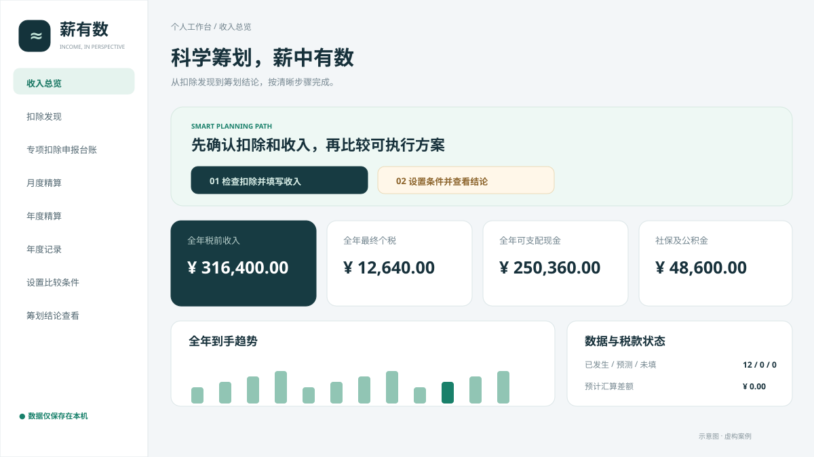
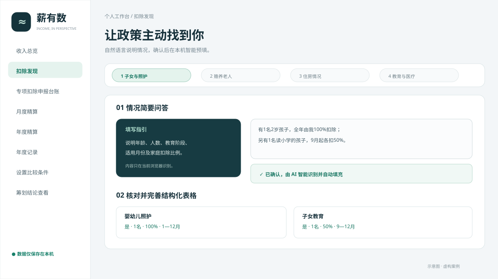
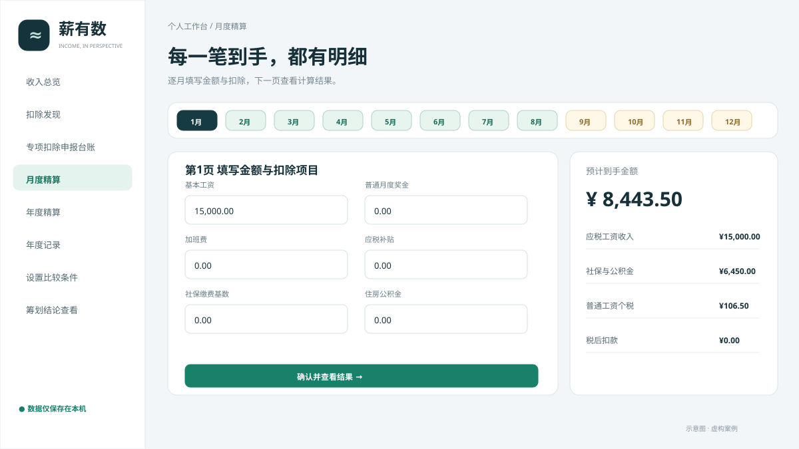
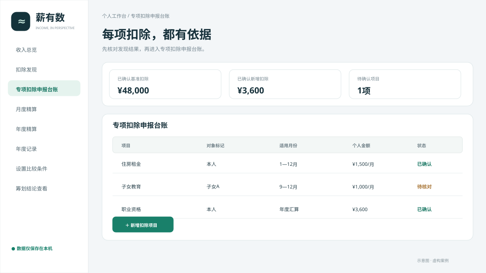
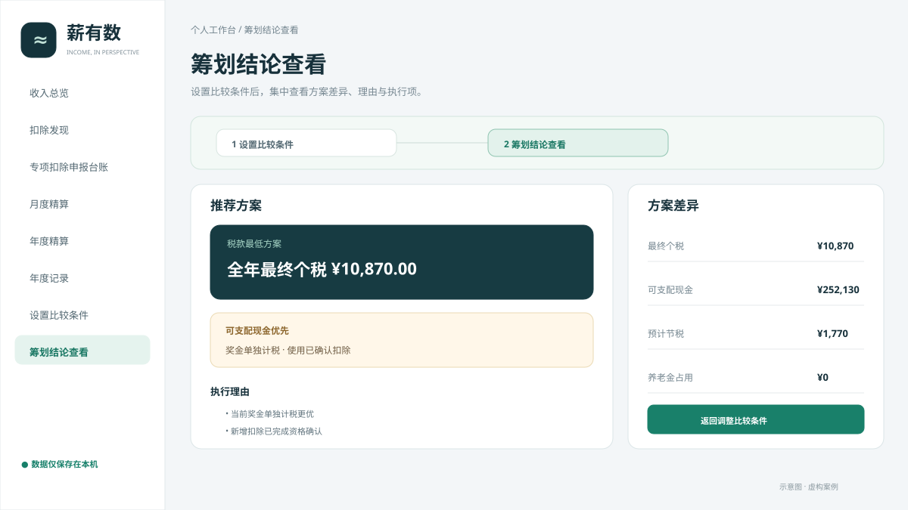

# 薪有数 · 个人收入与个税规划

[](https://github.com/yanxinrui27/xinyoushu-tax-planner/actions/workflows/pages.yml)

一个面向中国内地居民个人的纯前端收入与个税测算工具。它把扣除发现、月度及年度收入录入、专项附加扣除台账和筹划方案比较串成一条清晰流程。

**在线使用：** [https://yanxinrui27.github.io/xinyoushu-tax-planner/](https://yanxinrui27.github.io/xinyoushu-tax-planner/)

**公开演示账号：** `yanxinrui`　**密码：** `12345678`

公开演示账号会在首次进入时加载仓库内的虚构案例，方便在电脑、平板和手机上查看完整效果。它不是私密账号，请不要在该账号中录入真实个人信息。需要填写自己的数据时，请创建本机账号；新账号从空白数据开始，数据只保存在当前浏览器。



## 主要能力

- **主动发现扣除：** 通过四组生活情况问答发现可能适用的专项附加扣除，并支持用自然语言描述家庭情况后自动预填结构化表格。
- **月度精算：** 区分已发生、预测和未填写月份，计算工资、社保、公积金、工资个税、奖金税、当月到手及累计扣缴去向。
- **年度精算与年度记录：** 既可从连续的月度记录汇总到当前月份，也可独立填写年度合计，两种取数方式互不覆盖。
- **专项扣除申报台账：** 按项目、对象、月份、个人金额和使用环节记录，并检查额度、重复与住房互斥等冲突。
- **个税筹划与设计：** 在“设置比较条件”和“筹划结论查看”两个页面中比较奖金计税、已确认新增扣除和个人养老金组合。
- **账号数据隔离：** 同一浏览器可以创建多个本机账号，各账号的数据分别保存；没有服务端数据库，也不要求 GPT 或 GitHub 登录。
- **备份与迁移：** 支持 JSON 完整备份和 CSV 明细导出，便于更换浏览器或设备。

## 四步开始使用

### 1. 发现可能遗漏的扣除

进入“专项扣除发现与管理 → 扣除发现”，先用简短文字描述子女、老人、住房、教育或医疗情况，确认系统识别结果后再核对结构化字段。



### 2. 填写月度或年度收入

进入“月/年收入填写及测算”，按月录入适合持续跟踪到手收入；已有年度汇总数据时，可直接使用“年度精算”。



### 3. 核对专项扣除申报台账

把确认适用的项目写入台账，检查适用月份、个人扣除金额、家庭分配和资格状态。系统只把已经确认的项目带入正式计算。



### 4. 设置条件并查看筹划结论

在“个税筹划与设计”中先设置比较条件，再进入“筹划结论查看”，同时比较最终税款、可支配现金和方案成立条件。



完整操作说明见 [`docs/USER-GUIDE.md`](docs/USER-GUIDE.md)。

## 登录与数据规则

- 公开演示账号的用户名和密码写在网页及本文档中，只用于产品展示。
- 演示案例是虚构数据，并随网页一起发布，因此在不同设备登录演示账号都能看到初始案例。
- 自建账号从空白年度开始，工资和扣除记录只保存在当前网址对应的浏览器中。
- 本机密码用于区分当前浏览器中的账号空间，不是云端身份认证，也不能阻止有设备访问权限的人读取浏览器数据。
- 自建账号不支持跨设备自动同步。换设备前应导出 JSON 备份，再在新设备登录或创建账号后导入。

## 快速体验其他测试案例

仓库内置 4 组虚构测试案例，覆盖阶段汇总、完整年度奖金与筹划、年度自行填写和缺失月份阻断校验。登录自建账号后，在“设置与备份”中选择“导入备份”，再选择 [`test-data`](test-data) 中的 JSON 文件即可。

## 在本地运行

项目没有第三方运行依赖，也不需要构建。在仓库根目录执行：

```powershell
python -m http.server 8765 --directory dist
```

然后打开 [http://localhost:8765](http://localhost:8765)。页面使用 ES 模块，因此不能直接双击 `index.html`。

## 运行验证

```powershell
node test.mjs
node test-p01.mjs
node test-storage.mjs
node test-policy-finder.mjs
node test-auth.mjs
```

自动检查覆盖税率边界、累计预扣、奖金计税、扣除冲突、数据迁移、缺失月份、政策问答、本机账号和账号间数据隔离。推送到 `main` 后，GitHub Actions 会先运行全部检查和浏览器模块语法检查，通过后才发布 GitHub Pages。

## 适用范围

支持 2026、2027 年度，中国内地居民从年初在同一单位取得普通工资薪金，以及符合条件的全年一次性奖金场景。

暂不支持换工作、多单位、劳务报酬、境外所得、经营所得、减免税、特殊预扣、回款或销售提成优化。工具不能自动核验真实资格，结果需要与个人所得税 APP、凭证和税务机关口径核对。

## 项目结构

```text
dist/                       可直接发布的静态网页
  app.mjs                   页面状态与交互编排
  auth.mjs                  本机账号和密码校验
  profile.mjs               账号数据命名空间与演示案例初始化
  engine.mjs                个税和现金计算
  deductions.mjs            专项扣除台账规则
  policy-finder.mjs         主动式扣除发现规则
  storage.mjs               年度数据保存与迁移
  ui.mjs                    页面模板
  demo/default-case.json    公开虚构演示案例
  style.css                 响应式样式
.github/workflows/pages.yml 自动测试与 GitHub Pages 发布
test-*.mjs                  功能回归测试
test-data/                  虚构演示数据
docs/                       用户、架构与步骤配图
```

## 文档

- [用户使用指南](docs/USER-GUIDE.md)
- [架构与数据流](docs/ARCHITECTURE.md)
- [部署和迁移](DEPLOYMENT.md)
- [安全与隐私](SECURITY.md)
- [参与开发](CONTRIBUTING.md)

欢迎通过 Issue 提交可复现的问题或明确的改进建议。涉及税法规则的修改需要附上国家税务总局或其他主管机关的公开依据。
