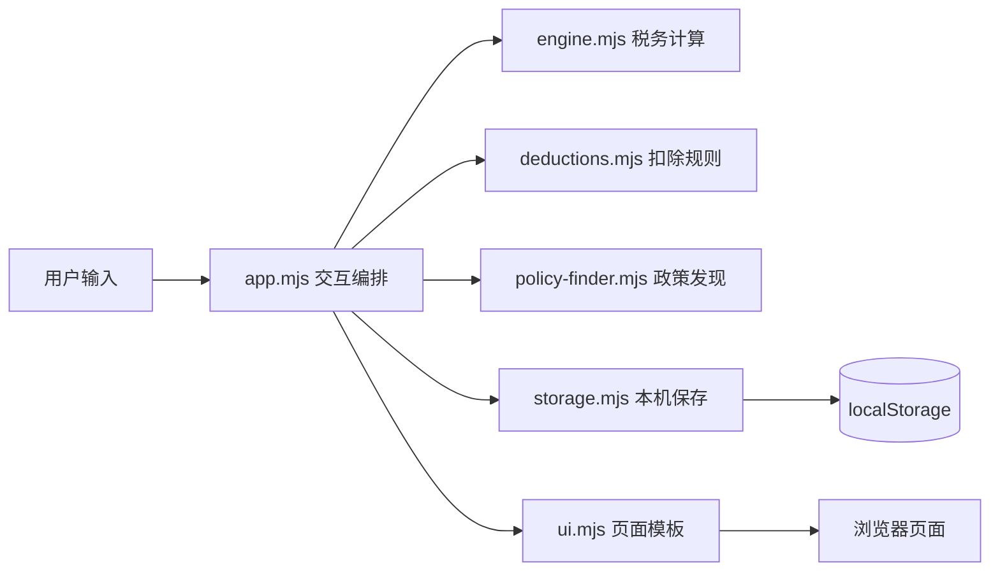

# 架构与数据流

## 技术形态

薪有数是无后端、无构建步骤的静态 Web 应用。GitHub Pages 只提供 HTML、CSS 和 JavaScript 文件；运行时状态和工资信息由浏览器保存。公开链接没有 GPT、GitHub 或应用内账号登录流程。

## 模块职责

| 模块 | 职责 |
| --- | --- |
| `index.html` | 页面入口和模块加载 |
| `app.mjs` | 状态切换、表单绑定、保存、导入导出和确认流程 |
| `engine.mjs` | 累计预扣、年度个税、奖金税、现金结果和方案组合 |
| `deductions.mjs` | 专项附加扣除额度、月份、对象和冲突校验 |
| `policy-finder.mjs` | 引导问答答案到候选扣除项目的确定性规则 |
| `storage.mjs` | 分年度存储、版本迁移、原子写入和旧版快照 |
| `ui.mjs` | 主工作台、流程页、结果页和台账的 HTML 模板 |
| `style.css` | 桌面与移动端响应式样式 |

## 数据边界

### `localStorage`

保存：

- 分年度工资、扣除、奖金和筹划输入；
- 最近使用年度；
- 数据迁移前的旧版快照。

工资数据是可读 JSON，没有加密。应用不保存 GPT、GitHub 或其他账号凭据。

### JSON 备份

备份只包含税务与收入状态。用户可以在新浏览器直接打开网页，再导入历史记录。

## 核心不变量

1. 所有金额在计算层使用“分”为整数单位，显示时再转换为元。
2. 未填写月份不按 0 元参与正式年度结果。
3. 已发生和预测收入分开标记；实际扣税缺失时明确使用预测值。
4. 个人缴费的现金影响和税前扣除不会重复计算。
5. 年度快算不会反向生成或覆盖月度记录。
6. 未确认基准扣除阻断正式结果，未确认备选扣除不参加比较。
7. 政策问答只生成候选建议，不自动认定资格。
8. 公开访问不引入远程账号、服务端会话或用户数据上传。

## 公开访问模型

`index.html` 加载 `app.mjs` 后，应用立即读取当前域名下的本地年度记录并渲染工作台，不检查 GPT、GitHub 或任何应用内登录状态。不同域名、浏览器和设备的本地存储互相隔离。

## 发布流程

所有 5 组测试和浏览器模块语法检查通过后，工作流才会发布 `dist/`。详细步骤见 [`../DEPLOYMENT.md`](../DEPLOYMENT.md)。
